# Zelo · cuidado contínuo antes da urgência

Aplicação web em Spring Boot desenvolvida para a disciplina de **Java Advanced** (Sprint 4, entrega final do Challenge FIAP 2026).

| Entrega | Link |
|---|---|
| Aplicação online | **[preencher com a URL do Render após o deploy]** |
| Vídeo de apresentação | **[preencher com o link do vídeo]** |
| Repositório | **[preencher com a URL do repositório]** |

> Para testar na hora, entre com uma das [contas de demonstração](#contas-de-demonstração). A senha de todas é `Zelo@123`.

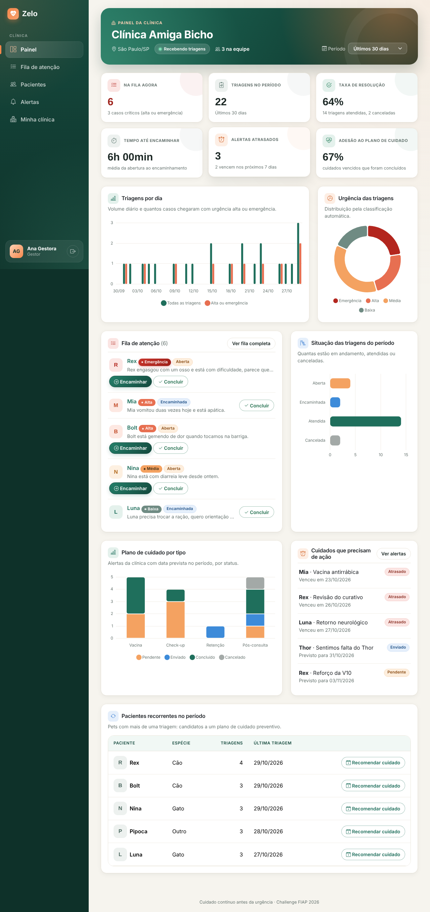

---

## Sumário

1. [O problema](#o-problema)
2. [A solução](#a-solução)
3. [Integrantes](#integrantes)
4. [Perfis e permissões](#perfis-e-permissões)
5. [Fluxos principais](#fluxos-principais)
6. [Painéis (dashboards)](#painéis-dashboards)
7. [Interface e experiência de uso (UI/UX)](#interface-e-experiência-de-uso-uiux)
8. [Arquitetura](#arquitetura)
9. [Diagrama de classes](#diagrama-de-classes)
10. [Modelo de dados (diagrama de relacionamento)](#modelo-de-dados-diagrama-de-relacionamento)
11. [Decisões de design e tecnologia](#decisões-de-design-e-tecnologia)
12. [Segurança](#segurança)
13. [Flyway e banco de dados](#flyway-e-banco-de-dados)
14. [Integração com as demais disciplinas](#integração-com-as-demais-disciplinas)
15. [Como executar](#como-executar)
16. [Contas de demonstração](#contas-de-demonstração)
17. [Testes automatizados](#testes-automatizados)
18. [Deploy](#deploy)
19. [O que mudou desde a Sprint 3](#o-que-mudou-desde-a-sprint-3)
20. [Estrutura do projeto](#estrutura-do-projeto)

---

## O problema

A maior parte das emergências veterinárias começa com sinais que poderiam ter sido percebidos antes: um vômito que se repete, uma vacina esquecida, um retorno que nunca aconteceu. Hoje a relação entre tutor e clínica é **reativa**. O tutor só procura atendimento quando o caso já é grave, e a clínica atende por ordem de chegada, sem saber quem precisa de atenção primeiro.

## A solução

O **Zelo** transforma a saúde do pet em uma **jornada acompanhada**. Ele tem três frentes:

1. **Triagem com urgência classificada.** O tutor descreve o que está acontecendo. O Zelo calcula um *score de risco* e um nível de urgência (baixa, média, alta ou emergência), e o caso entra na **fila priorizada** da clínica escolhida.
2. **Plano de cuidado contínuo.** Vacinas, check-ups, retornos pós-consulta e ações de retenção viram alertas com data. A clínica recomenda, envia o lembrete e o tutor confirma quando o cuidado foi feito.
3. **Visão longitudinal.** Cada pet tem uma **linha do tempo** com triagens e cuidados. A clínica tem **painéis com indicadores** de atendimento e de adesão ao plano de cuidado.

**Originalidade:** o foco não é agendar consultas (algo que muitos sistemas já fazem), e sim **agir antes da urgência**. O sistema mede isso com indicadores próprios: tempo até o encaminhamento, pacientes recorrentes e adesão aos cuidados vencidos. O código de convite da equipe protege os dados de saúde dos pacientes sem burocratizar a entrada de novos veterinários.

## Integrantes

| Nome | RM |
|---|---:|
| Gabriel Robertoni Padilha | 566293 |
| Hebert Lopes dos Santos | 563192 |
| Nicolas Monteiro Ramiro | 562380 |
| Marcus Vinícius Vila Nova da Silva | 558771 |
| Bruno Ferreira | 563489 |

## Perfis e permissões

Os três perfis podem ser criados pela tela **Criar conta**. Todos entram e caem direto no próprio painel.

| Perfil | Como é criado | O que pode fazer |
|---|---|---|
| **Tutor** | `/registro/tutor` | Cadastrar e editar pets, abrir e cancelar triagens, criar lembretes, confirmar cuidados e ver a linha do tempo de cada pet |
| **Veterinário** | `/registro/veterinario`, com o **código de convite** da clínica, ou cadastrado pelo gestor | Painel da clínica, fila de atenção, pacientes, histórico do paciente na clínica e recomendação e envio de cuidados |
| **Gestor** | `/registro/gestor` (cria a clínica junto) ou cadastrado por outro gestor | Tudo o que o veterinário faz, mais editar a clínica, pausar ou reativar o recebimento de triagens, montar a equipe, desativar acessos e renovar o código de convite |

Rotas protegidas por perfil:

| Rota | Acesso |
|---|---|
| `/`, `/login`, `/registro/**` | Público |
| `/tutor/**` | `TUTOR` |
| `/clinica/**` | `VETERINARIO` e `GESTOR` |
| `/clinica/gerenciar/**` | Somente `GESTOR` |
| `/api/auth/login`, `/api/auth/register` | Público (API mobile) |
| `/api/pets/**`, `/api/triagens/**`, `/api/alertas/**` | `TUTOR` com token JWT |

Além das rotas, cada serviço confere **a quem o dado pertence**. Um tutor não acessa o pet de outro tutor. Uma clínica não vê, não altera e não recomenda cuidados a quem não é paciente dela.

## Fluxos principais

### Fluxo 1: Triagem e encaminhamento

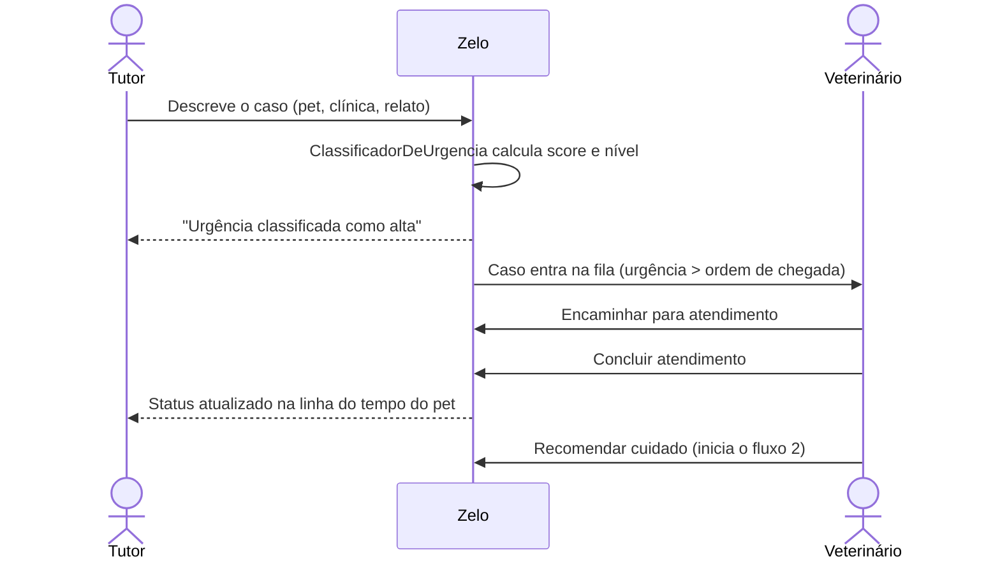

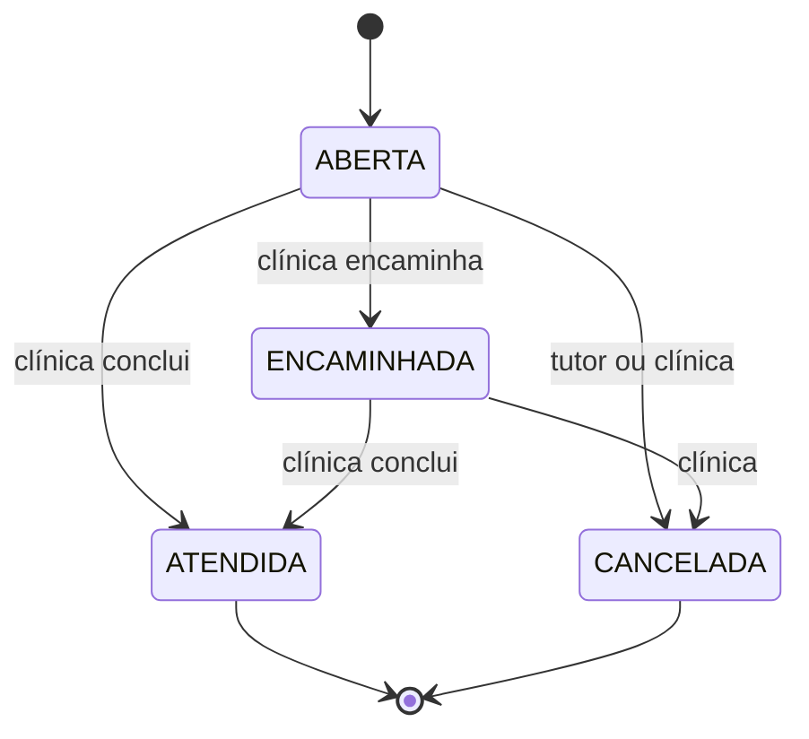

O classificador procura palavras-chave no relato, sem diferenciar acentos nem maiúsculas. A palavra mais grave define o nível (emergência 90, alta 65, média 40, baixa 15), e cada palavra adicional soma 3 pontos, até o máximo de 100. Ele reconhece formas femininas e verbais, como "intoxicad**a**" e "espirr**ando**".

### Fluxo 2: Plano de cuidado

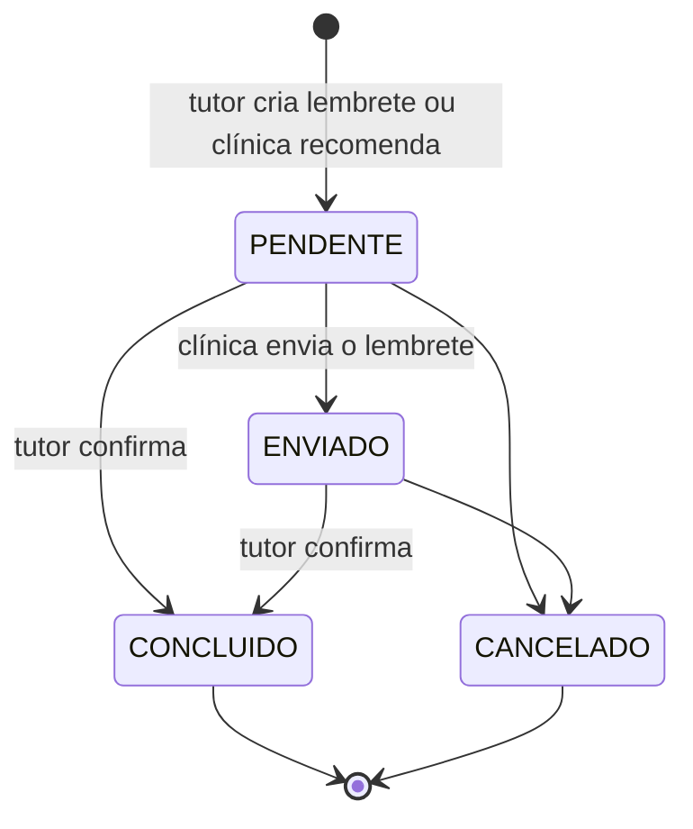

Um alerta aberto com a data prevista já vencida aparece como **Atrasado** em todas as telas e alimenta os indicadores.

As regras de transição ficam **dentro das entidades** (`Triagem.encaminhar()`, `Alerta.concluir()` etc.). Os serviços só buscam, validam a posse e delegam.

## Painéis (dashboards)

### Painel da clínica (`/clinica/painel`)

Tem filtro de período (7, 30 ou 90 dias) e mostra:

- **6 indicadores:** casos na fila agora (com quantos são críticos), triagens no período, taxa de resolução, tempo médio até o encaminhamento, alertas atrasados (e quantos vencem em 7 dias) e adesão ao plano de cuidado.
- **4 gráficos:** triagens por dia (total e críticas), distribuição por urgência, situação das triagens e plano de cuidado por tipo e status.
- **Listas de ação:** os 5 casos mais urgentes da fila (com botões de encaminhar e concluir), os cuidados atrasados ou próximos e os **pacientes recorrentes**, isto é, pets com várias triagens que são candidatos a um plano preventivo.

As contagens vêm de **consultas agregadas no banco** (`group by` com *constructor expressions* do JPQL). Só a série diária e o tempo médio são calculados em Java, a partir de uma projeção leve com as datas das triagens.

### Painel do tutor (`/tutor/painel`)

- **4 indicadores:** pets, cuidados pendentes, cuidados atrasados e triagens em andamento.
- **Situação de cada pet:** em dia, requer atenção ou cuidado atrasado, com o próximo cuidado e a última triagem.
- **Próximos cuidados** com o botão **Feito**, gráfico de urgência das triagens, plano de cuidado por tipo e triagens recentes.

## Interface e experiência de uso (UI/UX)

### Princípios que guiaram a interface

| Princípio | Como aparece no Zelo |
|---|---|
| **Identidade visual de produto** | As áreas logadas usam **menu lateral** (fixo no computador, gaveta no celular) com o avatar do usuário e atalho para registrar triagem. Os painéis abrem com uma faixa de destaque e trazem indicadores com ícones coloridos pelo tom (crítico, atenção, positivo), gráficos com barras arredondadas e cartões com cabeçalhos ilustrados. O login é dividido em marca e formulário, e cada perfil tem cor própria (tutor verde, veterinário azul, gestor coral). |
| **Cada perfil vê o que precisa fazer agora** | Após o login, cada perfil cai no próprio painel. O veterinário encontra a fila já priorizada, com os botões **Encaminhar** e **Concluir** no próprio painel. O tutor vê a situação de cada pet e confirma um cuidado com um clique (**Feito**). |
| **Urgência se lê pela cor** | A mesma paleta em selos, bordas dos cards e gráficos: vermelho (emergência), coral (alta), laranja (média) e cinza-verde (baixa). Status também têm cores fixas (pendente, enviado, concluído, cancelado e **atrasado**, em destaque). |
| **Nada de tela vazia ou de erro técnico** | Listas e gráficos sem dados mostram um estado vazio explicativo. Erros 400, 403, 404 e 500 têm páginas próprias, com caminho de volta. A tela genérica do servidor está desligada. |
| **Feedback a cada ação** | Toda ação mostra uma mensagem de sucesso ou do motivo da recusa (ex.: "Não é possível cancelar uma triagem já finalizada."). Depois de agir no painel, o usuário **volta para a mesma tela**. |
| **Formulários que ajudam** | As mensagens de validação aparecem embaixo de cada campo, em português, e **o que foi digitado é preservado**. Há dicas nos campos (ex.: CNPJ só com números, UF com 2 letras) e o login já vem com o e-mail preenchido depois do cadastro. |
| **Prevenção de erros** | Ações destrutivas (cancelar, desativar acesso, gerar novo convite, excluir pet) pedem confirmação. O botão é desabilitado após o clique, evitando envio duplicado. Pets com histórico não exibem a opção de excluir. |
| **Demonstração sem atrito** | Contas de demonstração preenchem o login com um clique, e a massa de dados é recriada a cada inicialização, com datas relativas ao dia. |
| **Responsiva e acessível** | Layout Bootstrap testado em 1366 px e 390 px (celular) sem rolagem horizontal, `lang="pt-BR"`, link "Pular para o conteúdo", `aria-label` nos gráficos e no menu, foco visível e contraste da paleta verde/creme. |
| **Consistência por construção** | Um único layout (Thymeleaf Layout Dialect) e fragmentos reutilizáveis (campos, botões de ação, selos, gráficos, linha do tempo e estados vazios) garantem que todas as telas se comportem igual. |

### Telas

| Página inicial | Escolha de perfil no cadastro |
|---|---|
| 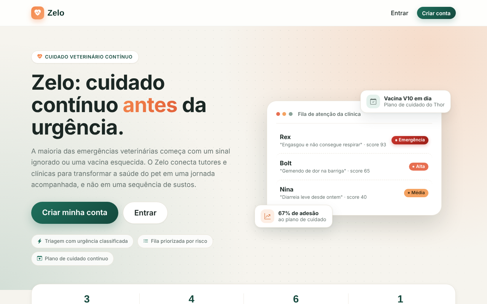 | 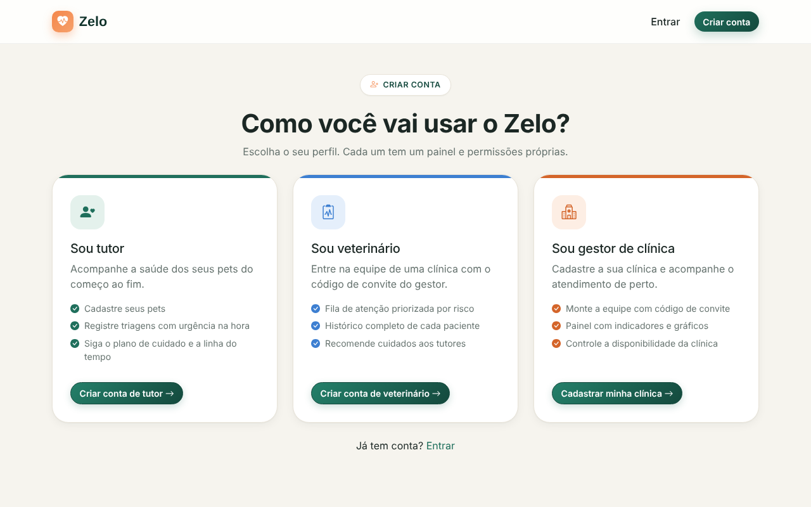 |
| **Login com contas de demonstração** | **Fila de atenção priorizada** |
| 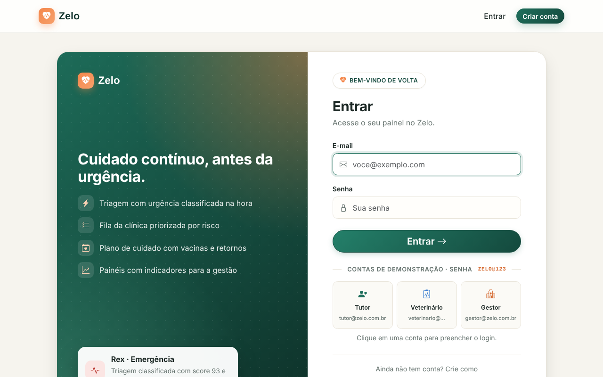 | 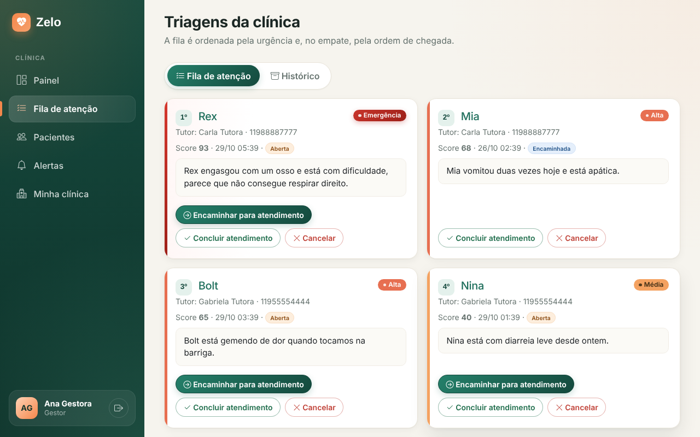 |
| **Equipe e código de convite (gestor)** | **Linha do tempo do pet (tutor)** |
| 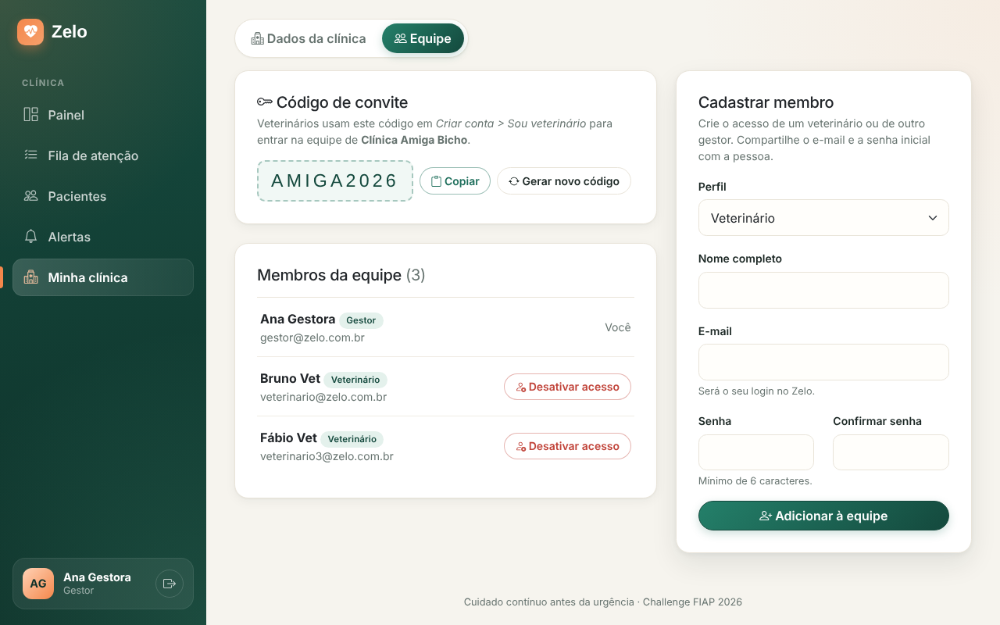 | 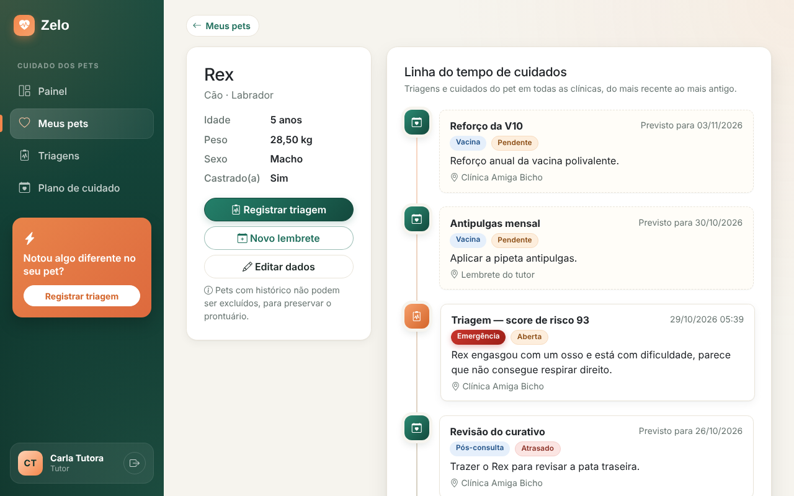 |
| **Validação nos formulários** | **Painel do tutor** |
| 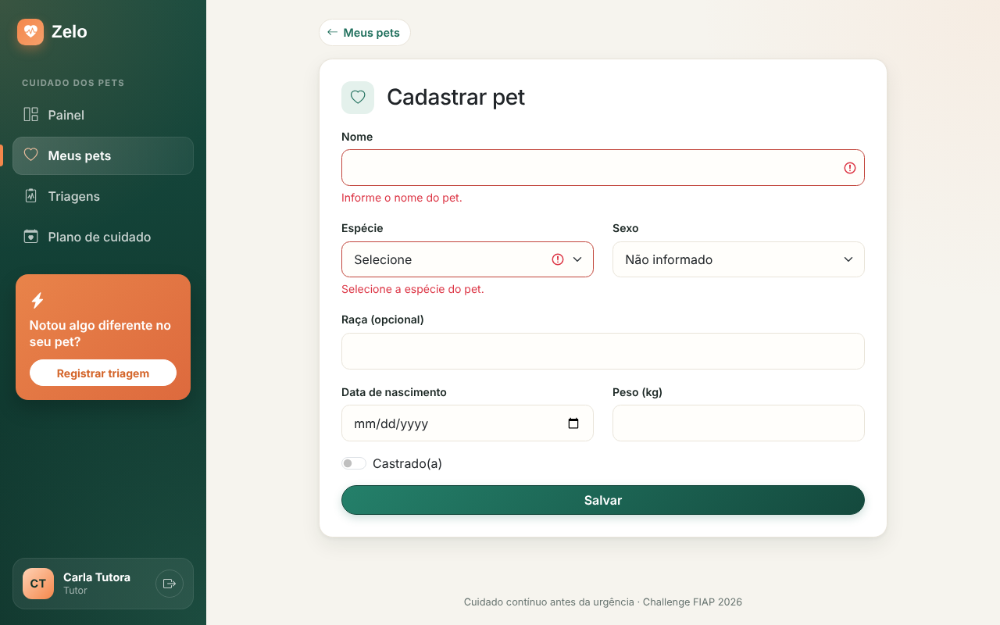 | 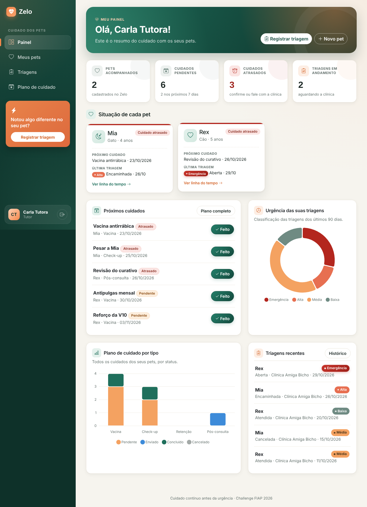 |

**No celular**

| Painel da clínica | Plano de cuidado do tutor | Menu lateral (gaveta) |
|---|---|---|
| 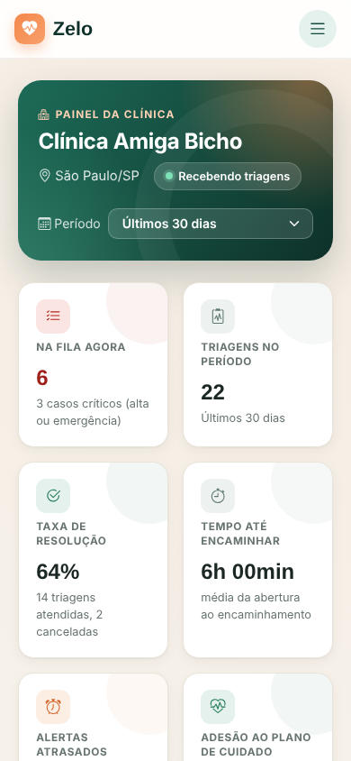 | 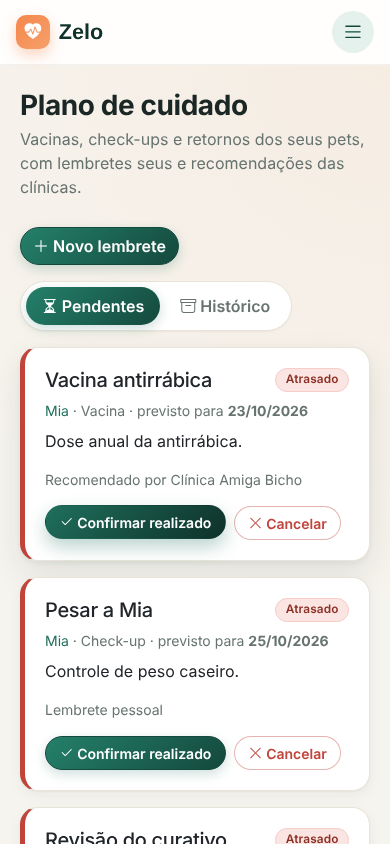 | 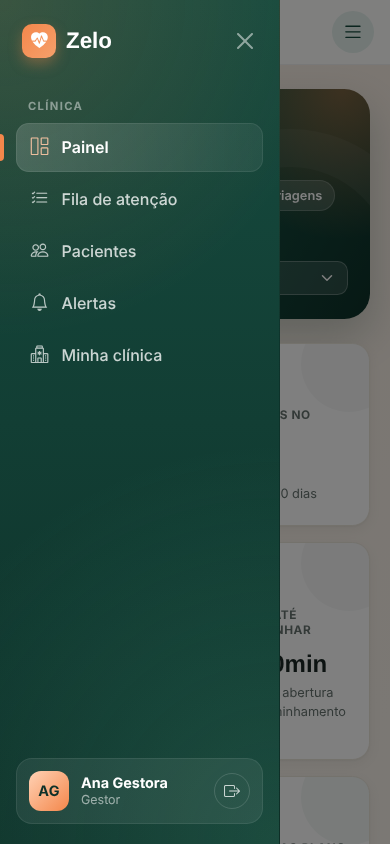 |

> A interface foi verificada em um navegador real (Chromium) com os três perfis, no desktop e no celular, sem erros de JavaScript nem páginas quebradas.

## Arquitetura

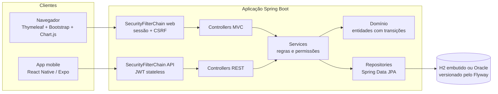

Fluxo de uma requisição: **Tela → Controller → DTO validado → Service → Domínio/Repository → Banco**.

## Diagrama de classes

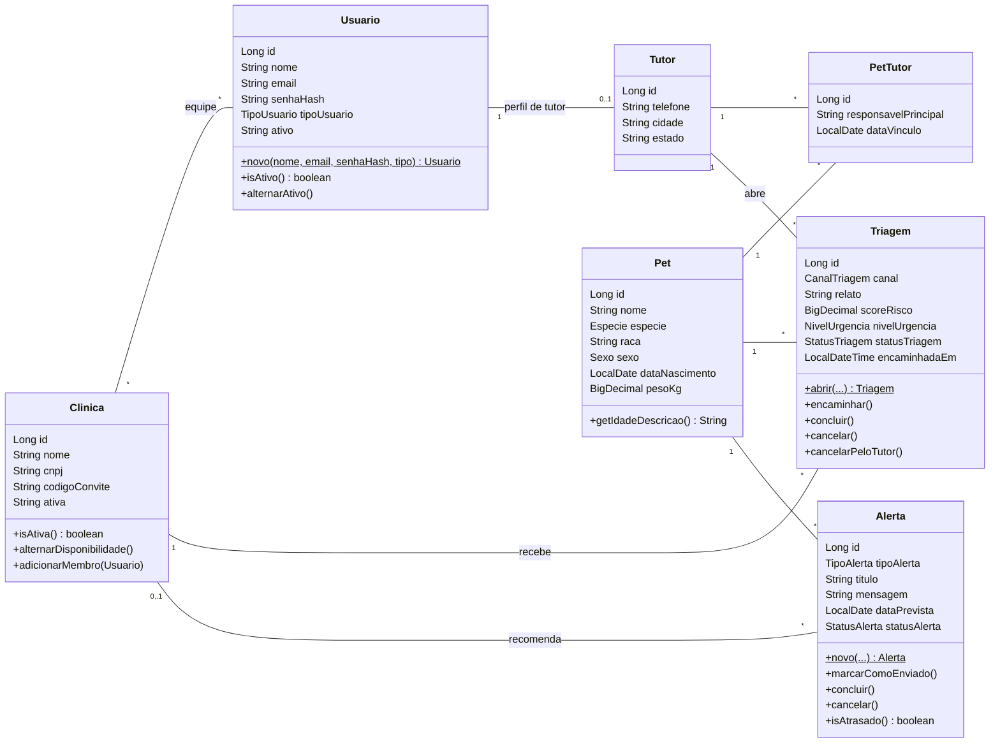

Principais serviços e as dependências entre eles:

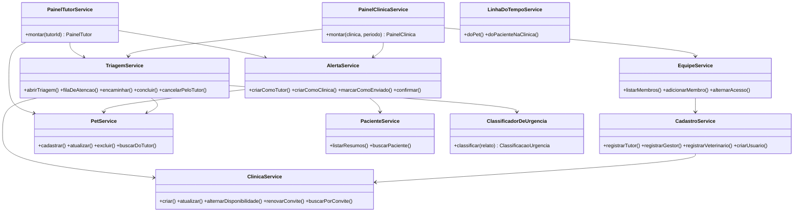

## Modelo de dados (diagrama de relacionamento)

As tabelas seguem o padrão do time de Banco de Dados (`T_CH_*`, prefixos `id_`, `nm_`, `ds_`, `tp_`, `st_`, `dt_`, `dh_`, `vl_`, `fl_`), com as mesmas constraints `CHECK`.

```mermaid
erDiagram
    T_CH_USUARIO ||--o| T_CH_TUTOR : "especializa"
    T_CH_USUARIO ||--o{ T_CH_CLINICA_EQUIPE : "integra"
    T_CH_CLINICA ||--o{ T_CH_CLINICA_EQUIPE : "possui"
    T_CH_PET ||--o{ T_CH_PET_TUTOR : "tem"
    T_CH_TUTOR ||--o{ T_CH_PET_TUTOR : "cuida"
    T_CH_PET ||--o{ T_CH_TRIAGEM : "recebe"
    T_CH_TUTOR ||--o{ T_CH_TRIAGEM : "abre"
    T_CH_CLINICA ||--o{ T_CH_TRIAGEM : "atende"
    T_CH_PET ||--o{ T_CH_ALERTA : "tem"
    T_CH_CLINICA |o--o{ T_CH_ALERTA : "recomenda"

    T_CH_USUARIO {
        NUMBER id_usuario PK
        VARCHAR2 nm_usuario
        VARCHAR2 ds_email UK
        VARCHAR2 ds_senha "BCrypt"
        VARCHAR2 tp_usuario "TUTOR, VETERINARIO, GESTOR"
        CHAR st_usuario "S ou N"
        TIMESTAMP dt_criacao
    }
    T_CH_TUTOR {
        NUMBER id_tutor PK
        NUMBER id_usuario FK,UK
        VARCHAR2 nr_telefone
        VARCHAR2 nm_cidade
        CHAR sg_estado
    }
    T_CH_CLINICA {
        NUMBER id_clinica PK
        VARCHAR2 nm_clinica
        VARCHAR2 nr_cnpj UK
        VARCHAR2 cd_convite UK "V3"
        CHAR st_clinica "S ou N"
        VARCHAR2 nm_cidade
        CHAR sg_estado
    }
    T_CH_CLINICA_EQUIPE {
        NUMBER id_clinica PK,FK
        NUMBER id_usuario PK,FK
    }
    T_CH_PET {
        NUMBER id_pet PK
        VARCHAR2 nm_pet
        VARCHAR2 tp_especie "CAO, GATO, OUTRO"
        CHAR tp_sexo
        DATE dt_nascimento
        NUMBER vl_peso_kg
        CHAR fl_castrado
    }
    T_CH_PET_TUTOR {
        NUMBER id_pet_tutor PK
        NUMBER id_pet FK
        NUMBER id_tutor FK
        CHAR fl_principal
        DATE dt_vinculo
    }
    T_CH_TRIAGEM {
        NUMBER id_triagem PK
        NUMBER id_pet FK
        NUMBER id_clinica FK
        NUMBER id_tutor FK
        VARCHAR2 tp_canal
        VARCHAR2 ds_relato
        NUMBER vl_score_risco "0 a 100"
        VARCHAR2 tp_urgencia
        VARCHAR2 st_triagem
        TIMESTAMP dh_encaminhamento
        TIMESTAMP dt_criacao
    }
    T_CH_ALERTA {
        NUMBER id_alerta PK
        NUMBER id_pet FK
        NUMBER id_clinica FK "nulo = lembrete do tutor"
        VARCHAR2 tp_alerta
        VARCHAR2 nm_alerta
        DATE dt_prevista
        TIMESTAMP dh_envio
        VARCHAR2 st_alerta
    }
```

## Decisões de design e tecnologia

| Decisão | Por quê |
|---|---|
| **Spring Boot 3.3 + Java 17** | Versão LTS e o ecossistema visto na disciplina (MVC, Data JPA, Security, Validation). |
| **Thymeleaf + Layout Dialect** | Telas renderizadas no servidor, com um layout único e fragmentos reutilizáveis (campos de formulário, botões de ação, selos, gráficos e linha do tempo). Isso evita repetir HTML em cada página. |
| **Bootstrap, ícones e Chart.js via WebJars** | As bibliotecas de front-end são servidas pela própria aplicação. A interface não depende de CDN externa no dia da apresentação. |
| **Oracle automático, com H2 de reserva** | Ao iniciar, a `SelecaoDeBanco` tenta o Oracle do grupo. Se ele responder e tiver as tabelas do time de BD, a aplicação usa o Oracle sozinha; senão (sem rede, FIAP fora do ar, tabelas ausentes ou qualquer falha ao subir), usa o H2 em modo Oracle. O sistema nunca deixa de abrir por causa do banco. |
| **Flyway como dono do schema** (`ddl-auto: none`) | Toda mudança de banco é uma migration versionada e revisável. |
| **Domínio rico** | As regras de transição ficam nas entidades (`Triagem`, `Alerta`, `Clinica`). Os serviços ficam enxutos e as regras são testadas sem Spring. |
| **Duas `SecurityFilterChain`** | A web usa sessão, formulário e CSRF. A API mobile usa JWT, não guarda sessão e responde 401/403 em JSON. Cada cadeia tem uma responsabilidade. |
| **JWT com o Resource Server do Spring** | Substituiu o token feito à mão da Sprint 3 pela implementação padrão (Nimbus, HS256, validação de emissor e expiração). |
| **Código de convite para veterinários** | Permite o cadastro público de veterinários (pedido do professor) sem que qualquer pessoa consiga ler os dados de saúde de uma clínica. |
| **"Paciente" = pet que abriu triagem na clínica** | A equipe só vê e recomenda cuidados para quem é paciente dela (privacidade e LGPD). |
| **Consultas agregadas e projeções** | Os painéis contam no banco (`group by`) em vez de carregar listas inteiras. `open-in-view` está desligado e as consultas usam `join fetch`/`@EntityGraph`, sem N+1. |
| **`Clock` injetável** | Os painéis calculam "hoje" por um relógio injetado, o que facilita testes. |
| **Padrões `Feedback` e `Formulario`** | O tratamento de sucesso e erro das ações e formulários foi extraído para dois utilitários, em vez de `try/catch` repetido em cada controller. |

## Segurança

- Senhas com **BCrypt**. O segredo do JWT vem de variável de ambiente em produção. Os dados de acesso ao Oracle do grupo ficam como padrão em `SelecaoDeBanco`, por decisão do grupo, para a conexão ser automática; podem ser trocados pelas variáveis `ORACLE_URL`, `ORACLE_USER` e `ORACLE_PASSWORD`.
- **CSRF** ativo em todos os formulários. O token é inserido automaticamente pelo Thymeleaf.
- Autorização em **duas camadas**: rotas por perfil (`SecurityConfig`) e posse do dado nos serviços.
- Acesso **desativado** pelo gestor bloqueia o login e invalida o JWT na hora, porque o usuário é recarregado a cada requisição da API.
- Redirecionamentos pós-ação só aceitam caminhos internos (`Feedback.destinoSeguro`), o que previne *open redirect*.
- Páginas de erro amigáveis (400, 403, 404 e 500). A tela genérica do servidor está desligada.

## Flyway e banco de dados

```text
src/main/resources/db/migration/
├── h2/                                   ← padrão (aplicação autônoma)
│   ├── V1__create_schema.sql             schema completo, espelho do DDL do time de BD
│   ├── V2__seed_data.sql                 contas e pets de demonstração
│   ├── V3__codigo_convite_clinica.sql    nova coluna cd_convite (Sprint 4)
│   └── V4__dados_demonstracao.sql        2ª clínica, tutores, 26 triagens e alertas datados
└── oracle/                               ← perfil "oracle" (ligado sozinho quando o Oracle responde)
    ├── V1__create_equipe_table.sql       tabela própria da aplicação Java
    ├── V2__seed_data.sql                 contas de demonstração
    ├── V3__codigo_convite_clinica.sql    nova coluna cd_convite (Sprint 4)
    └── V4__dados_demonstracao.sql        mesma massa de demonstração do H2, protegida por WHERE NOT EXISTS
```

- As datas da `V4` são **relativas ao momento da migração**, então os painéis sempre mostram os "últimos 30 dias" com dados.
- No perfil `oracle`, as tabelas principais, o package `PKG_T_CH_ZELO` e a trigger de auditoria são criados pelo script da disciplina de Banco de Dados ([`2TDSR_CodigoSql_Zelo.sql`](docs/evidencias/banco/2TDSR_CodigoSql_Zelo.sql), usado **sem nenhuma alteração**). O Flyway usa `baseline-on-migrate` e aplica apenas o que é da aplicação Java.
- As seeds do Oracle são **idempotentes** e **convivem com os dados do time de BD**: cada `INSERT` só executa se o dado ainda não existir, e cada pet de demonstração é localizado pelo nome **e pelo tutor dono** (o script de BD também tem pets chamados Thor, Luna, Nina e Mia).
- **Histórico do Flyway sempre alinhado** (`FlywayOracleConfig`): antes de migrar, o `repair` realinha o histórico caso uma migration já aplicada tenha tido o texto ajustado; como as migrations do Oracle são idempotentes, isso não duplica dados.
- **Ressincronização automática** (`FlywayOracleConfig`): se o time de BD executar o script de novo, ele recria as tabelas `T_CH_*`, mas não conhece o que é só do Java (`T_CH_CLINICA_EQUIPE`, `cd_convite` e o histórico do Flyway). Na inicialização seguinte, a aplicação detecta isso, descarta apenas esses objetos próprios e reaplica as migrations. Nenhum objeto do time de BD é tocado.
- As contas criadas pelo script de BD (`ana.souza@...` etc.) têm senhas ilustrativas, não BCrypt: servem às consultas e relatórios da disciplina de BD. Para entrar no sistema, use as [contas de demonstração](#contas-de-demonstração).
- **Validado em um Oracle real (Oracle Database Free) com o script do time de BD:** script executado sem alterações (todos os objetos `VALID`), as 4 migrations do Java por cima, o login dos 3 perfis, todas as telas e os fluxos de triagem e plano de cuidado, com painéis idênticos aos do H2. A trigger `TRG_T_CH_AUDITORIA_TRIAGEM` registrou em `T_CH_AUDITORIA_DML` os `INSERT`s e `UPDATE`s feitos pela aplicação, e `PKG_T_CH_ZELO.PR_T_CH_EXIBIR_TRIAGEM_JSON` exporta em JSON as triagens criadas pelo Java. Também foi validada a reexecução do script de BD com a aplicação já instalada.
- As urgências e os scores da massa de demonstração são conferidos por um teste automatizado contra o classificador real.

## Integração com as demais disciplinas

> **Atenção, grupo:** confiram esta seção e completem os links (marcados com ✏️) com os artefatos de cada disciplina antes da entrega.

| Disciplina | Como aparece no Zelo | Evidência |
|---|---|---|
| **Mastering Relational and Non-Relational Database** | Modelo `T_CH_*`, nomes, tipos e `CHECK`s idênticos aos do script do time de BD. Perfil `oracle` roda sobre esse script, sem alterá-lo, com Flyway. As triagens criadas pelo Java são auditadas pela trigger `TRG_T_CH_AUDITORIA_TRIAGEM` e exportadas em JSON pelo package `PKG_T_CH_ZELO`. | Script do time de BD: [`docs/evidencias/banco/2TDSR_CodigoSql_Zelo.sql`](docs/evidencias/banco/2TDSR_CodigoSql_Zelo.sql). `db/migration/`, seção [Modelo de dados](#modelo-de-dados-diagrama-de-relacionamento). ✏️ print das tabelas no SQL Developer |
| **Mobile Application Development** | API REST (`/api/**`) com JWT, consumida pelo app React Native/Expo: login, cadastro, pets, triagens, alertas e clínicas. | [`docs/API_MOBILE.md`](docs/API_MOBILE.md). ✏️ link do repositório do app |
| **Disruptive Architectures (IoT, IoB & Generative AI)** | O classificador de urgência é a linha de base determinística e auditável. O campo `ds_analise_visual` e os canais `AUDIO`/`IMAGEM` já estão previstos para receber a análise do modelo de IA. | `ClassificadorDeUrgencia`. ✏️ link do protótipo de IA |
| **DevOps Tools & Cloud Computing** | Dockerfile multi-stage, deploy no Render (`render.yaml`) e *health check* do Actuator. | `Dockerfile`, `render.yaml` |
| **Compliance, Quality Assurance & Tests** | Suíte com testes unitários, de repositório e de integração ponta a ponta. Privacidade por design: "paciente", convite e posse do dado. | [Testes automatizados](#testes-automatizados) |
| ✏️ **Demais disciplinas** | ✏️ descrever | ✏️ link |

## Como executar

**Pré-requisito:** JDK 17 ou superior. Não precisa instalar Maven nem banco de dados.

```bash
git clone <URL-DO-REPOSITORIO>
cd zelo-java
./mvnw spring-boot:run          # Windows: mvnw.cmd spring-boot:run
```

Acesse **http://localhost:8080**.

**Qual banco é usado?** A aplicação tenta primeiro o **Oracle do grupo**, sem precisar configurar nada. Se ele não responder em alguns segundos, ou se o usuário não tiver as tabelas do time de BD, ela segue com o **H2 embutido**, criado e populado pelo Flyway a cada inicialização. O console mostra qual foi escolhido na linha `Database:` (`jdbc:oracle:...` ou `jdbc:h2:mem:...`).

No Oracle, a ordem é: 1) o time de BD executa `2TDSR_CodigoSql_Zelo.sql` no usuário do grupo; 2) a aplicação sobe e aplica as migrations do Java por cima.

Outras formas de executar:

```bash
# Perfil de desenvolvimento (console do H2 em /h2-console, JDBC URL jdbc:h2:mem:zelodb, usuário sa, sem senha)
./mvnw spring-boot:run -Dspring-boot.run.profiles=dev

# Gerar o jar e executar
./mvnw clean package
java -jar target/zelo-java.jar

# Docker
docker build -t zelo-java .
docker run -p 8080:8080 zelo-java

# Forçar o H2, sem tentar o Oracle
ZELO_ORACLE=false ./mvnw spring-boot:run

# Usar outro Oracle ou outro usuário
export ORACLE_URL=... ORACLE_USER=... ORACLE_PASSWORD=...
./mvnw spring-boot:run
```

| Variável de ambiente | Uso | Padrão |
|---|---|---|
| `PORT` | Porta HTTP | `8080` |
| `ZELO_JWT_SECRET` | Segredo HS256 do JWT da API (mínimo 32 caracteres). **Defina em produção.** | valor local de desenvolvimento |
| `ORACLE_URL`, `ORACLE_USER`, `ORACLE_PASSWORD` | Conexão com o Oracle | Oracle da FIAP, usuário do grupo |
| `ZELO_ORACLE` | `false` força o H2, sem tentar o Oracle | tenta o Oracle |

## Contas de demonstração

Senha de todas: **`Zelo@123`**. Na tela de login, basta clicar em uma conta para preencher.

| Perfil | E-mail | Contexto |
|---|---|---|
| Tutor | `tutor@zelo.com.br` | Carla, tutora do Rex e da Mia |
| Veterinário | `veterinario@zelo.com.br` | Bruno, da Clínica Amiga Bicho |
| Gestor | `gestor@zelo.com.br` | Ana, gestora da Clínica Amiga Bicho (código de convite `AMIGA2026`) |
| Tutor | `tutor2@zelo.com.br`, `tutor3@zelo.com.br` | Felipe (Thor, Luna) e Gabriela (Bolt, Nina, Pipoca) |
| Veterinário | `veterinario2@zelo.com.br`, `veterinario3@zelo.com.br` | Elisa (Vet Center Paulista) e Fábio (Amiga Bicho) |
| Gestor | `gestor2@zelo.com.br` | Diego, gestor do Vet Center Paulista (código `PAULISTA26`) |

## Testes automatizados

```bash
./mvnw test
```

A suíte roda sobre um H2 novo e isolado, criado pelas **mesmas migrations** da aplicação.

| Camada | Classes | O que garante |
|---|---|---|
| Domínio | `TriagemTest`, `AlertaTest`, `ClinicaTest`, `PetTest` | Transições de status permitidas e negadas, atraso de alertas e código de convite |
| Serviços (Mockito) | `TriagemServiceTest`, `AlertaServiceTest`, `PetServiceTest`, `CadastroServiceTest`, `EquipeServiceTest`, `ClassificadorDeUrgenciaTest` | Regras de negócio, posse dos dados, ordenação da fila e classificação |
| Validação e suporte | `ValidacaoFormulariosTest`, `FeedbackTest`, `PeriodoEFormatosTest` | Mensagens dos formulários, senhas iguais, UF, bloqueio de redirecionamento externo e formatação |
| Repositórios | `RepositoriosJpaTest` | Consultas agregadas, `join fetch`, pacientes e consistência da massa de demonstração com o classificador |
| Painéis | `PaineisIntegracaoTest` | Indicadores e gráficos batem com os dados, e cada clínica só vê os próprios números |
| Integração web | `NavegacaoPorPerfilTest`, `CadastroIntegracaoTest`, `FluxoTriagemIntegracaoTest`, `FluxoAlertaIntegracaoTest`, `EquipeIntegracaoTest`, `ClinicaIndisponivelIntegracaoTest` | **Todas as telas renderizam** para cada perfil, as rotas são protegidas, os 3 cadastros entram no próprio painel e os fluxos funcionam de ponta a ponta |
| API | `ApiIntegracaoTest` | JWT, respostas 401/403/400/422 em JSON, CRUD de pets, triagens, alertas e CORS do app |
| Convivência com o banco do grupo | `FlywayOracleConfigTest`, `SelecaoDeBancoTest` | Escolha automática entre Oracle e H2 (com queda para o H2 quando o Oracle não responde). Quando o script de BD recria as tabelas, só os objetos do Java são descartados e reaplicados; nas demais situações, nada é tocado |

## Deploy

O passo a passo completo está em [`docs/DEPLOY.md`](docs/DEPLOY.md). Resumo: o Render lê o `render.yaml`, constrói a imagem pelo `Dockerfile`, gera o `ZELO_JWT_SECRET` e monitora `/actuator/health`. No plano gratuito, o serviço "dorme" depois de 15 minutos sem acesso. O primeiro acesso seguinte leva cerca de 1 minuto e recria a massa de demonstração.

## O que mudou desde a Sprint 3

| Feedback ou problema | O que foi feito |
|---|---|
| "Faltam os diagramas de classes e de relacionamento" | Diagramas de classes, ER, estados, sequência e arquitetura neste README |
| "Não deixa cadastrar novos Gestores e Veterinários" | Cadastro público dos 3 perfis (gestor cria a clínica, veterinário entra por código de convite) e tela de equipe do gestor |
| "Dashboard simples" | Painéis com 6 indicadores, 4 gráficos, filtro de período, fila acionável, pacientes recorrentes e situação por pet, em um visual novo: menu lateral, faixa de destaque, indicadores com ícones por tom e gráficos refinados |
| Exigência de "boa UI e UX" da Sprint 4 | Navegação por perfil com menu ativo, cores de urgência e status consistentes, estados vazios, confirmações, mensagens de feedback, validação por campo, rótulos em português (ex.: "Emergência", "Pós-consulta" em vez de `EMERGENCIA`, `POS_CONSULTA`) e layout responsivo. Veja [Interface e experiência de uso](#interface-e-experiência-de-uso-uiux) |
| "Apresentação com erros durante a execução" | Oracle automático com H2 de reserva (o sistema abre mesmo sem o Oracle), front-end sem CDN, correção de erros 500 (UF, CNPJ, período, IDs inválidos) e de um loop infinito ao renovar o convite. Telas e fluxos cobertos por testes |
| Credenciais no `application.yml` | Removidas: tudo por variável de ambiente |
| API mobile devolvia 500 e redirecionamento | Cadeia própria com JWT: 401/403/400/422 em JSON |
| Código repetido e controllers extensos | Layout único, fragmentos, `Feedback`/`Formulario`, transições no domínio e controllers separados por perfil |
| Classificador ignorava formas femininas | "intoxicada", "atropelada", "apática", "espirrando" etc. reconhecidos |
| Clínica via e alertava qualquer pet | Só pacientes da clínica |
| Telas sem histórico | Abas de histórico, linha do tempo do pet e página do paciente |

## Estrutura do projeto

```text
src/main/java/br/com/fiap/zelo/
├── config/            SecurityConfig (2 cadeias), JwtConfig, RelogioConfig
├── domain/            entidades com regras de transição, CodigoConvite e enums com rótulos
├── exception/         ZeloException e especializações
├── repository/        Spring Data JPA + projecao/ (records das consultas agregadas)
├── security/          usuário autenticado, JWT da API, respostas 401/403 e redirecionamento por perfil
├── service/           regras de negócio
│   ├── painel/        painéis da clínica e do tutor, gráficos e indicadores
│   └── linhadotempo/  linha do tempo do pet
└── web/
    ├── controller/    controllers MVC, separados por perfil
    ├── api/           API REST do aplicativo mobile
    ├── dto/           formulários validados (+ validacao/ com @Uf e @SenhasConferem)
    ├── advice/        tratamento de erros (telas e API)
    └── suporte/       Feedback, Formulario e atributos comuns das telas

src/main/resources/
├── db/migration/      migrations do Flyway (h2 e oracle)
├── templates/         layout/, fragments/, painel/, cadastro/, pets/, triagens/, alertas/, pacientes/, clinicas/, error/
└── static/            css/app.css, js/app.js, js/painel.js, favicon.svg
```

---

Projeto acadêmico. FIAP, Análise e Desenvolvimento de Sistemas, Challenge 2026.
